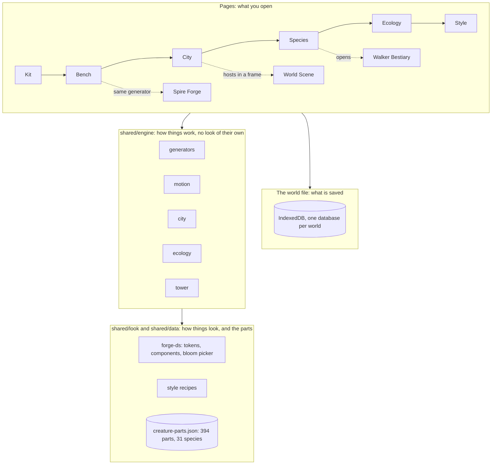
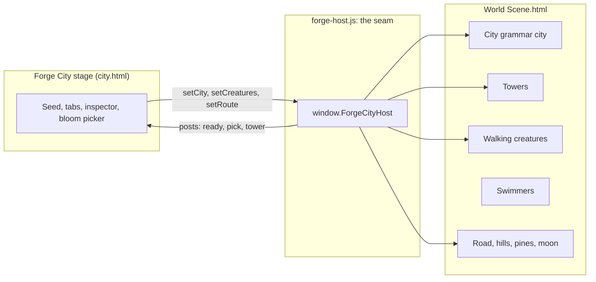
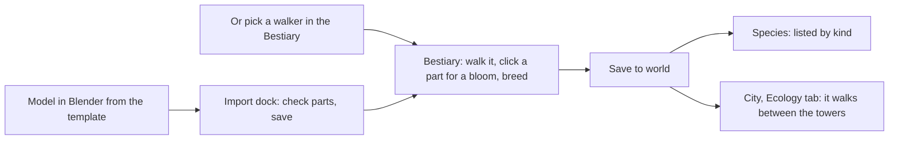
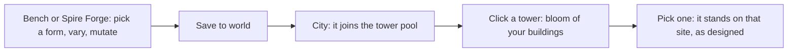
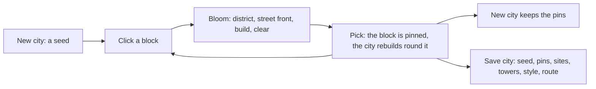
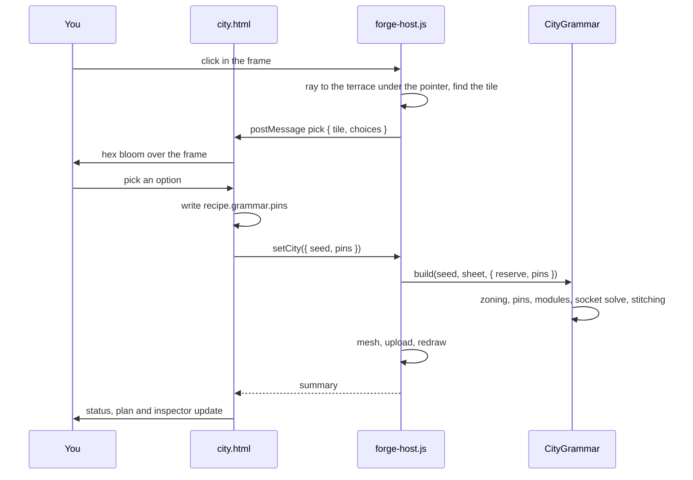
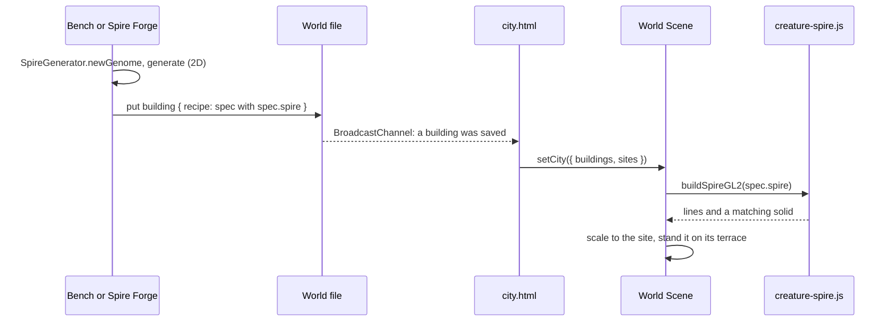
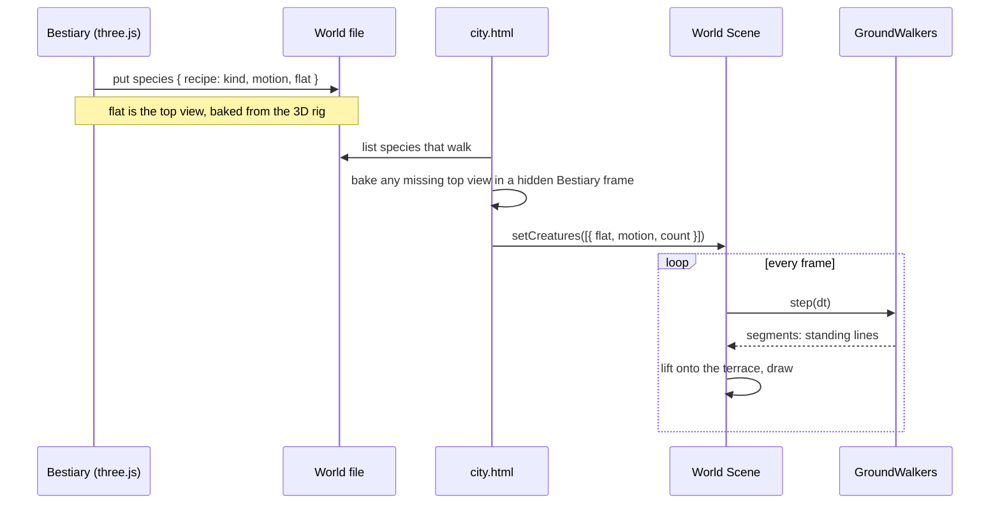

# Forge: system documentation

Written 2026-11-10, after the consolidation pass on branch `machine-stance` (commit `dbf2090`).
Forge is a browser tool for **procedural generation and animation**: it makes creatures, buildings and a city from one kit of hand-drawn parts, and shows them moving in one 3D world. Everything is static files; there is no server and no build step.

Contents:

1. [What changed in this cycle](#1-what-changed-in-this-cycle)
2. [The system at a glance](#2-the-system-at-a-glance)
3. [The world file](#3-the-world-file-the-data-model)
4. [Forge's pages](#4-forges-pages)
5. [Procedural generation](#5-procedural-generation)
6. [Animation](#6-animation)
7. [The 3D world](#7-the-3d-world)
8. [Flows](#8-flows)
9. [Technology by part](#9-technology-by-part)
10. [Checks, and how to run it](#10-checks-and-how-to-run-it)
11. [What is still split](#11-what-is-still-split)

A review of what to improve next is in [`forge-review.md`](./forge-review.md).

---

## 1. What changed in this cycle

Listed by outcome. Commit ids are on `machine-stance`.

| Area | What was done | Commits |
|---|---|---|
| **Creatures from Blender** | A Blender mock (`mech.glb`) walks as solids with two-bone IK at the modelled knee. A Blender template (`tools/blender/forge_mech.py`, `.blend`) labels parts so any GLB made from it imports with its legs, neck and tail understood. | `0d91b80` … `9e4749d` |
| **The qilin** | The Blender mech became a qilin: a neck carrying the head, a tufted tail, longer legs at the body's ends, and a trot and gallop driven by a phase clock. | `5c0006c`, `5d01c36` |
| **One walker** | The walking code moved out of the Bestiary into `shared/engine/motion/walker.js`. Neck, tail and running gaits became data that any creature can carry. | `fbac94f` |
| **One gait rulebook** | `shared/engine/motion/gaits.js` holds the gaits. The 3D walker, the 2D rig, Ecology and the scene all step by it. | `971faf6` |
| **Creature records** | One record shape for every creature kind (`shared/engine/creature-record.js`), a Species page grouped by kind, and "bloom of blooms" breeding. | `e8764b7`, `084c544` |
| **Hex bloom everywhere** | The bloom picker is how Forge offers variations: on a creature part in 3D, on a city block, on a tower. | `084c544`, `ee299b3`, `b3749e3` |
| **Import and motion pages** | A Blender import dock (`import.html`) and a motion rack (`motion.html`) with the Bestiary embedded as the 3D preview. | `834ccfe` |
| **Creatures in the city** | Saved walking creatures carry a baked top view and walk the city. | `5554842` |
| **New building forms** | The building generator gained a shaft wall, lancets, arcades, stepped buttresses, pinnacles, eaved roofs, a gate, and four templates: pagoda, gothic, hall, gate. | `0f1c8ae` |
| **City stage is the 3D world** | Forge's City stage hosts World Scene. Click a block for a bloom (district, street front, build, clear); the pick is a pin and the grammar rebuilds round it. | `ee299b3` |
| **Buildings stand as designed** | The 3D builder now builds every form the 2D generator draws. The world's buildings are the city's towers; click a tower to choose which stands there. | `b3749e3` |
| **Ecology and Route in 3D** | Walking creatures walk the 3D city. The road leaves the gate with poles, wire and pilgrims. The stage has City, Ecology and Route tabs. | `b3749e3` |
| **Consolidation** | Route Scene, the old route studies and the Persian-era city tools were deleted with the five engine modules only they used. Spire Forge now uses the shared building generator. Forge's seam moved out of World Scene into `forge-host.js`. About 13,500 lines removed. | `dbf2090` |

Design work alongside the code lives on the canvas "Forge — End to End": the Species band, the Beast variations board, five "Improve" boards and four flow boards.

---

## 2. The system at a glance

Forge has four layers. Each layer only reads the one below it.



Two rules hold the design together:

- **Mechanism and look are separate.** An engine module moves joints or lays out a building and draws nothing. A style recipe or a skin decides how it looks. Any engine can pair with any look.
- **A saved thing is a recipe, not a picture.** Every object stores the numbers and part ids that made it, so any page can rebuild it, vary it, or stand it up in 3D.

---

## 3. The world file (the data model)

`world/forge/web/forge-world.js`. One IndexedDB database per world, one object store, one record shape for everything.

```
{ id, type, version, name,
  recipe,            // the numbers and part ids that rebuild it
  seed, refs[],      // refs: the parts and objects it is made from
  sockets[], prefab, // prefab: where a building may stand, what it attracts
  style,             // the style recipe it is drawn in
  svg, thumb,        // a drawing where a reader needs real art; a small preview
  source, createdAt, updatedAt }
```

| `type` | Made in | What `recipe` holds |
|---|---|---|
| `building` | Bench, Spire Forge, City | A Tower spec with the whole Spire design inside it as `spec.spire` |
| `species` | Bestiary, Import, Rig | `kind`, `motion { appendage, neck, tail, run }`, `tweak`, and `flat` (a baked top view) |
| `city` | City | `seed`, `grammar { pins, sites, towers, style, route, homes }`, plus the plot map's `pins` and `placements` |
| `seal`, `script`, `ruleset`, `style` | Bench, Rules, Style | Their own generator's parameters |

Every save is announced on a `BroadcastChannel`, so another open tab or a hosted frame redraws. Selection is shared the same way: pick a building in one page and the others outline it.

A few per-viewer settings live in `localStorage`: the active world, and how many of each creature walk.

---

## 4. Forge's pages

All in `world/forge/web/`. `forge-shell.js` draws the stage rail and the shelf; `workspace.html` is the one-shell wrapper.

| Stage | Page | What it does |
|---|---|---|
| Kit | `kit.html` | The parts sheet: species, roles, which parts a world uses |
| Bench | `bench.html` | Runs any registered generator with its controls, inputs and sockets, and saves the result |
| | `compose.html`, `attach.html`, `rig.html`, `rules.html` | Compose a creature from parts, set attach points, rig and motion, rule sets for bay dressing |
| City | `city.html` | **The 3D world** (World Scene in a frame) with City, Ecology and Route tabs. A second view, Plots, is the older flat plot map |
| Species | `species.html`, `import.html`, `motion.html` | Creatures by kind; the Blender import dock; the motion rack |
| Ecology | `ecology.html` | The top view: variants, drift, captures, what each building attracts |
| Style | `style.html` | Style recipes: palette, bands, lines, atmosphere |
| | `lineage.html` | What was made from what |

Standalone tools that feed Forge live in `world/forges/`: `walker-bestiary` (creatures in 3D), `spire-forge` (the building generator on its own page), `sigil-forge`, `tower-forge`, and others.

---

## 5. Procedural generation

| What is generated | Module | Technique |
|---|---|---|
| **Buildings** (2D elevation) | `shared/engine/generators/spire-generator.js` | A *genome*: numbers for massing (terraces, shaft, balconies, drums, crown) and part ids for dressing. Nine templates. Bays are dressed by a small rule table (`family.level.position`). `mutate` changes one gene at a time |
| **Buildings** (3D) | `shared/engine/tower/creature-spire.js` | Reads the same genome and builds each section as it reads in the round: terraces wrapped on their cylinder, crown fans swept round the axis, roofs and domes spun from their profile, a gate as a flat frame |
| **The city** | `shared/engine/city/city-grammar.js` + three CSV sheets | Four layers. *Height*: terraces, highest at the centre. *Zoning*: districts placed by rule (arc, patch, spoke, ring). *Modules*: a dual grid in the manner of Townscaper, where each tile picks its shape from which of its four corners are built, and a small wave-function-collapse solve makes neighbouring street fronts meet. *Stitching*: retaining walls, stairs, gates, bridges. Built lots clump through smooth value noise |
| **City pins** | same | `opts.pins` fixes a lot's district, built or open state, or a tile's street front; the socket solve reworks the neighbours |
| **Tower sites and the plot map** | `shared/engine/city/city-wfc.js` | Wave function collapse on a ring-and-wedge grid, with pinned cells |
| **Terrain** (plot map) | `shared/engine/generators/terrain.js` | Noise height field with contours |
| **Seals and alphabets** | `shared/engine/generators/sigil-generator.js` | Parametric radial constructions and stroke grids |
| **Creatures** | `world/forges/walker-bestiary/`, `shared/engine/mech/` | A body plan with slots; parts fill slots; a gene per slot |
| **Variations** | `shared/engine/bloom.js`, `shared/look/forge-ds/bloom-picker.js` | The hex bloom: a ring of options laid out round the thing you clicked, ordered by a shape distance, each option a small render of the result |
| **Breeding and search** | `shared/engine/evolve/` | Crossover gene by gene; MAP-Elites for an atlas of distinct designs |
| **The road and hills** | `shared/engine/world/route-atmo-gl2.js` | A road polyline from the first avenue's gate; ridges as contour lines of a noise field |

**The registry.** `shared/engine/generators/forge-registry.js` is one contract every generator implements: defaults, controls, inputs, sockets, run, mutate, to-record. Register a generator in `forge-generators.js` and it appears in Bench with its controls and save.

**Seeded.** Every generator draws from a seeded generator (mulberry32), with a tag per stream, so the same seed gives the same result and one change does not reshuffle the rest.

---

## 6. Animation

| What moves | Module | Technique |
|---|---|---|
| **Limbs** | `shared/engine/motion/ik.js` | Two-bone IK with a pole direction for knees; FABRIK for chains of any length, with a bias so long limbs keep an arch |
| **Walking in 3D** | `shared/engine/motion/walker.js` | Feet plant on the ground and step when they fall too far behind their home. The body follows the feet, leans into turns and can rear. Necks and tails are chains driven by the body |
| **Gaits** | `shared/engine/motion/gaits.js` | One rulebook: on-demand stepping for a walk, phase-clock gaits (trot, gallop, pace, bound) for a run, picked by speed in leg lengths per second, with a landing handover between them |
| **Walking in the city** | `shared/engine/ecology/ground-walkers.js`, `CityGrammar.walkGraph` | Each creature picks a tower, walks to it and lingers. In the 3D city the way there is an A* path over the grammar's walkable graph: open lots, ring roads, and the stairs where an avenue climbs a terrace. A creature can be given a building it keeps to. Feet step by the same gait rules. `segments()` gives the creature as standing line segments for a 3D host |
| **Swimmers** | `shared/engine/ecology/ecology-sim.js` | Boids with a personality per species: schooling, hunting, fleeing, stalking, dashes. Towers stir vortices that gather them |
| **Drift over generations** | `shared/engine/generators/ecology-loop.js` | Variants are released, compete and drift; buildings attract species |
| **Interface motion** | `shared/look/forge-anim.js` | Crossfades and pulses on anime.js |

A creature's motion is data on its record: `motion { appendage: qilin | dragon | scorpion | swan | none, run: horse | strider | none }`. The Blender template writes the same two fields, so a model arrives already knowing how it moves.

---

## 7. The 3D world

`world/scenes/world-scene/World Scene.html` is one raw WebGL2 scene: the city, its towers, the swimmers, the walking creatures and the layers round the city. It runs on its own, and Forge's City stage hosts it in a frame.



`window.ForgeCityHost` is the whole interface:

| Call | Does |
|---|---|
| `setCity({ seed, pins, towers, buildings, sites })` | A new seed builds a new world. New pins rebuild only the city. New buildings or sites stand the towers again |
| `setCreatures(list)` | The world's walking creatures |
| `ecology()`, `setPop(key, n)`, `play(on)` | The swimmers |
| `route()`, `setRoute(flags)`, `viewRoad()` | The road, pilgrims, hills, pines, moon, street walkers |
| `summary()`, `plan()` | What was built, and every lot for the small district plan |
| `styles()`, `setStyle(id)`, `frame()`, `highlight(key)`, `sleep(on)` | Look, camera, selection, and pausing while the page saves |

**Towers have two drawings.** Across the city a tower is drawn from ornament simplified to about half a screen pixel; the full drawing is built the first time the tower fills a third of the view.

**Undo and drafts.** Every change in the City stage is a step of a history (`Undo`, `Redo`, Ctrl or Cmd + Z), and the unsaved city is kept as a draft in `localStorage` until it is saved or discarded.

**How it is drawn.** Each object is built twice: a solid that writes depth, and a line drawing that is the visible identity. A *style recipe* (`shared/look/style/style-recipes.js`) is a shared GLSL chunk plus data: stepped depth bands from ink to fog, warmed by distance to lantern points. Seven recipes ship (Route Zero, Route Zero blue, Ash, Paper, Glitch, Engraving, Relief) and Forge's Style page saves more.

---

## 8. Flows

### User flows

**Make a creature and see it in the world**



**Make a building and stand it in the city**



**Shape the city**



### System flows

**A pin on a city block**



**A building, from Bench to the 3D city**



**A walking creature, from the Bestiary to the city**



---

## 9. Technology by part

| Part | Technology | Why |
|---|---|---|
| Forge's pages | Plain HTML, CSS and classic scripts. No framework, no bundler | Every page opens from disk and stays readable |
| Storage | IndexedDB, BroadcastChannel, a little localStorage | A world is a local file of recipes; tabs stay in step |
| 2D generators (buildings, seals, alphabets, plot map) | SVG strings built in JavaScript | Vector art from hand-drawn SVG parts, exportable |
| The 3D world | Raw WebGL2 (GLSL ES 3.00), no engine | One draw pipeline for city, towers, creatures and atmosphere |
| The Bestiary, import dock | three.js (ES modules from a CDN), GLTFLoader | Skinned and rigid GLB models, orbit camera |
| IK, gaits, walker | Plain JavaScript on three.js-shaped vectors | Mechanism that any renderer can ride |
| Swimmers | Plain JavaScript boids, drawn on the GPU from a per-creature spine texture | Hundreds of bending creatures in one draw |
| City rules | Three CSV sheets, read at load | Edit districts, modules and sockets in a spreadsheet |
| Style recipes | Data plus one shared GLSL chunk | The same look in every program that pastes the chunk |
| Design system | CSS custom properties (`shared/look/forge-ds`), built from `tokens.json` | One vocabulary for every page |
| Interface motion | anime.js from a CDN | Small crossfades and pulses |
| Blender | Python (`bpy`) template that labels parts and writes motion fields | A model arrives understood |
| Tower Forge desktop | Rust: `forge-core`, `forge-search`, `forge-gltf`, `forge-cli`, and a Bevy + egui app | The same tower rules outside the browser |
| Checks | Node, Playwright, Chromium with software GL | Opens the real pages and exercises them |
| Hosting | Static files (a `.vercelignore` is present) | Nothing to run |

---

## 10. Checks, and how to run it

**Run it.** Serve the repo root and open `world/forge/web/index.html`:

```
python3 -m http.server 8731
```

**Checks.** `tools/check/run.mjs` serves the repo, opens pages in Chromium and fails on script errors.

```
cd tools/check && THREE_DIR=<path to node_modules/three> node run.mjs [filter]
```

| Check | What it proves |
|---|---|
| `forge-pages` | Every Forge page loads without a script error |
| `data-paths` | Every page that reads the shared data finds it |
| `compose-quad`, `compose-blade-to-3d` | Composed creatures build and reach 3D |
| `bestiary-walkers`, `bestiary-remix` | Every walker walks without a NaN; the bloom remix keeps it walking |
| `city-stage` | A click on a block opens the bloom, a pick pins it, the pin survives a new seed |
| `city-world` | Forge buildings stand as the towers from their own design, every form builds in 3D, creatures walk, the road exists |

---

## 11. What is still split

These are the known places where two things still do one job. They were kept on purpose in the last pass.

- **The Plots view** in City is the older flat plot map on `city-wfc.js`. It is a different generator from the 3D city on the same seed. The Ecology top view depends on it.
- **The Ecology top view** (`ecology.html`) keeps variants, drift, captures and what each building attracts. The 3D Ecology tab has creature counts and swimmers only.
- **The Tower engine** (`tower-engine.js`, `tower-engine-gl2.js`, Tower Forge, the Tower panel in World Scene) is still there. Forge buildings no longer need it to stand.
- **Walkers and buildings.** Walkers keep to the streets and stairs, but buildings do not yet attract them by species, and they pass through each other.
