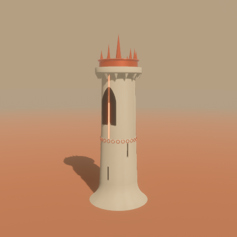

# Tower Forge (Rust)

The native version of Tower Forge: the same towers as the browser tool, built on an engine-free
core so the rules can run in a desktop app, on the command line, in tests, and later in the
browser through WebAssembly and inside Blender.

```
recipe (Spec)  →  plan (TowerPlan)  →  geometry (meshes)
  what you edit     parts, copies,        triangles, built
                    typed sockets,        on demand
                    diagnostics
```

## Crates

| Crate | What it holds | Depends on |
|---|---|---|
| `forge-core` | The recipe, the recipe → plan compiler, typed sockets, geometry, scoring and traits, the 12 presets | serde, glam, earcutr |
| `forge-search` | MAP-Elites: atlas, mutation, gene-by-gene crossover, locks, pins, a learned preference model | forge-core |
| `forge-gltf` | Plan → `.glb` with tags and sockets in `extras`, and the recipe inside the file | forge-core |
| `forge-cli` | The `forge` command: build, inspect and search without a window | the three above |
| `forge-app` | The desktop app: Bevy viewport, egui panels, atlas window | the above, Bevy 0.20, bevy_egui 0.43 |

Only `forge-app` knows about Bevy. Everything else is plain Rust.

## Run it

Install Rust from https://rustup.rs (1.97.1 or newer, which Bevy 0.20 needs), then from this folder:

```sh
# the desktop app (first build takes several minutes)
cargo run --release -p forge-app

# open a preset, or a spec file that reloads whenever you save it
cargo run --release -p forge-app -- pilgrim
cargo run --release -p forge-app -- my-tower.json

# render a tower to a PNG with no window (previews, thumbnails, servers)
cargo run --release -p forge-app -- --render divine divine.png 1280 960

# the command line
cargo run --release -p forge-cli -- presets
cargo run --release -p forge-cli -- build divine -o divine.glb
cargo run --release -p forge-cli -- plan pilgrim
cargo run --release -p forge-cli -- atlas --x height --y habitat --iters 20000 --glb-dir atlas-towers

# tests
cargo test
```

Mac and Windows need nothing else. On Linux, install the X11 and Vulkan development packages your
distribution lists for Bevy; audio and gamepads are switched off, so ALSA and udev are not needed.



## The app

- **Left panel:** tabs for Tiers, Crown & foot, Aura and Look.
  - Tiers: pick a tier and set its shape, surface, openings, band, turrets, stair, banners and buttresses.
  - Crown & foot: crown type, foot type and lean.
  - Aura: halos, debris, beam, motes, bridge, roots and satellite pillars.
  - Look: sky, colours, weathering, bloom and seed.
- **Viewport:** left-drag orbits, right-drag pans, the wheel zooms. Space pauses the animation.
- **Atlas:** the MAP-Elites grid.
  - Choose any two traits for the axes: height, slenderness, ornament, aura, habitat for creatures, tiers, symmetry or silhouette variety.
  - Click a cell to open its tower; the app learns from your choice. Right-click a cell to pin it.
  - "Breed from the last two pins" seeds the grid with their crossover children.
  - The "Keep fixed" locks hold parts of the current tower steady.
- **Code:** the same JSON as the browser Tower Forge's Code dialog. Paste from either into the other.
- **Undo:** Ctrl/Cmd+Z undoes and Shift+Ctrl/Cmd+Z redoes. A whole slider drag counts as one step.
- **Files:** drop a `.json` spec or a Tower Forge `.glb` onto the window to open it, and it reloads
  when the file changes. Export writes `exports/tower-….glb` and `.json`.
- **Status line:** coherence, with its parts (stability, joints, proportion), and every diagnostic
  from the plan.

## What a .glb contains

- One mesh per part. Every copy is a node that reuses the mesh, so repeated pieces stay instances
  in Blender. Leaning parts are baked, because glTF node matrices cannot shear.
- Every mesh node has `extras.tag`, for example `crown_gothic`, `band_balcony` or `halo_portal_ring`.
- Every socket is an empty named `socket:<id>`. Its `extras.socket` holds the type, direction,
  rule, accepted partners, radius and what it is connected to.
- The scene's `extras.forge.spec` holds the full recipe, so a `.glb` reopens as an editable tower.

## Scoring

- **Coherence** = 0.4 × joints + 0.3 × stability + 0.3 × proportion, minus any plan problems.
  - Joints: the width jump and the change of slope where tiers meet.
  - Stability: the volume-weighted centre of mass over the base, plus a top-heavy check.
  - Proportion: crown, halos and bands sized to the tower.
- **Fitness in the atlas.** Once you pin or pick towers, fitness becomes 0.65 × coherence +
  0.35 × taste. Taste blends similarity to your pins with the learned preference model.
- **Variation.** Small mutations always run alongside crossover, following Hutchinson et al.
  (2026). The preference model follows Gallotta et al.'s preference-learning emitters (2022).

## Not ported yet

- Naqsh patterns. They stay in the recipe but are not drawn natively.
- Cloud bands.
- Kit loading from the SVG sheet and glTF.
- Thumbnails in the atlas. Cells show their fitness and crown initial for now.

All four are in the Tower Kit Pipeline Plan. The next step there is `forge-kit-svg`.
